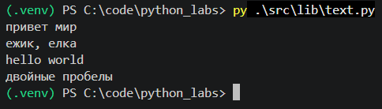
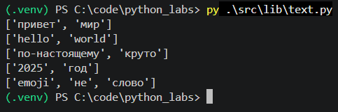
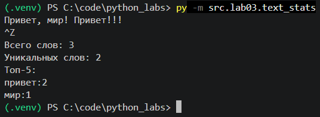

# ЛР3 — Тексты и частоты слов (словарь/множество)

### Цель: нормализовать текст, аккуратно токенизировать, посчитать частоты слов и вывести топ-N.

---

- [Задание A](#задание-a)
- - [normalize](#normalize)
- - [tokenize](#tokenize)
- - [count_freq + top_n](#count_freq--top_n)
- [Задание B](#задание-b)

---

# Задание A

## normalize

```py
def normalize(text: str, *, casefold: bool = True, yo2e: bool = True) -> str:
    """
    Выполняет нормализацию текста:
    приводит к нижнему регистру, заменяет ё на е, убирает управляющие символы, обрезает края и схлопывает пробелы.

    """

    if casefold:
        text = text.casefold()
    else:
        text = text.lower()

    if yo2e:
        text = text.replace('ё','е')

    text = text.replace('\t',' ').replace('\r',' ').replace('\n',' ')

    text = text.strip()
    return ' '.join(text.split())
```


## tokenize

```py
def tokenize(text: str) -> list[str]:
    """Разбивает текст на список слов (токенов), сохраняя дефисы внутри слов."""

    return re.findall(r'\w+(?:-\w+)*', text)
```


## count_freq + top_n

```py
def count_freq(tokens: list[str]) -> dict[str, int]:
    """Подсчитывает частоту встречаемости каждого слова в списке."""

    freq = {}
    for w in tokens:
        freq[w] = freq.get(w, 0) + 1
    return freq


def top_n(freq: dict[str, int], n: int = 5) -> list[tuple[str, int]]:
    """
    Возвращает список из N самых часто встречающихся слов.
    Сортировка выполняется сначала по убыванию частоты слова,
    а при равных частотах - по алфавиту.

    """

    pairs = sorted(freq.items(), key = lambda p: (-p[1], p[0]))
    return pairs[:n]
```


---

# Задание B

```py
import sys
from src.lib.text import normalize, tokenize, count_freq, top_n

if __name__ == "__main__":
    # Считываем весь многострочный текст из стандартного ввода до символа EOF
    stdin_text = sys.stdin.read()

    normalized_text = normalize(stdin_text)
    tokens = tokenize(normalized_text)
    frequencies = count_freq(tokens)
    top_words = top_n(frequencies, n=5)

    print(f'Всего слов: {len(tokens)}')
    print(f'Уникальных слов: {len(frequencies)}')
    print('Топ-5:')
    for word, count in top_words:
        print(f'{word}:{count}')
```
