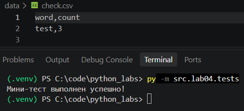

# ЛР4 — Файлы: TXT/CSV и отчёты по текстовой статистике

### Цель: закрепить работу с файлами (чтение/запись, кодировки), автоматизировать сбор статистики по словам и выгружать её в CSV.

---

# Задание A

## read_text

По умолчанию функция читает текст в utf-8. Но если передать encoding="cp1251", она сможет открыть файлы и скрипт не упадёт с ошибкой `UnicodeDecodeError`.

```py
import csv
from pathlib import Path

def read_text(path: str | Path, encoding: str = "utf-8") -> str:
    """
    Читает файл целиком в одну строку. По умолчанию кодировка UTF-8.

    Если нужно прочитать файл в кодировке Windows, вызывайте так:
    read_text("data/input.txt", encoding="cp1251")

    """
    
    p = Path(path)
    return p.read_text(encoding=encoding)
```

## write_csv

```py
def write_csv(rows: list[tuple | list], path: str | Path, header: tuple[str, ...] | None = None) -> None:
    """
    Создает или перезаписывает CSV-файл с разделителем-запятой.

    Если передан header, он записывается первой строкой.
    Если строки в rows имеют разную длину, вызывается ошибка ValueError.

    """
    
    p = Path(path)

    if len(rows) > 0:
        etalon_len = len(rows[0])
        for row in rows:
            if len(row) != etalon_len:
                raise ValueError("Все строки в rows должны иметь одинаковую длину!")

    with p.open("w", newline="", encoding="utf-8") as f:
        w = csv.writer(f)
        if header is not None:
            w.writerow(header)
        for r in rows:
            w.writerow(r)
```

# Мини‑тесты


# Задание B

Если файл input.txt пустой, скрипт запишет в report.csv только одну строку заголовка — word,count. Это нужно, чтобы Excel или другие программы потом не ломались при открытии пустой таблицы.

```py
import sys
from src.lab04.io_txt_csv import read_text, write_csv
from src.lib.text import count_freq, normalize, tokenize, top_n

def main() -> None:
    input_path = "data/input.txt"
    output_path = "data/report.csv"

    try:
        text = read_text(input_path, encoding="cp1251")
    except FileNotFoundError:
        print(f"Ошибка: Входной файл не найден по пути: {input_path}")
        sys.exit(1)

    normalized_text = normalize(text)
    tokens = tokenize(normalized_text)
    frequencies = count_freq(tokens)
    sorted_rows = sorted(frequencies.items(), key=lambda kv: (-kv[1], kv[0]))

    write_csv(sorted_rows, output_path, header=("word", "count"))
    print(f"Всего слов: {len(tokens)}")
    print(f"Уникальных слов: {len(frequencies)}")
    print("Топ-5:")
    for word, count in top_n(frequencies, 5):
        print(f"{word}:{count}")

if __name__ == "__main__":
    main()
```

# Тест‑кейсы

## A.


## B.


## C.
