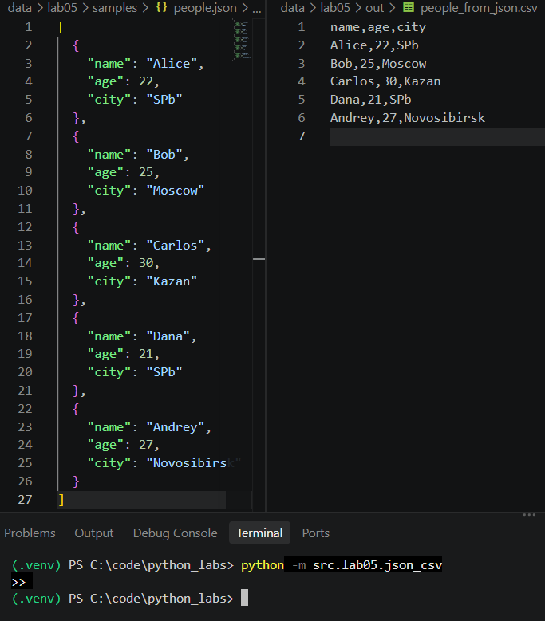
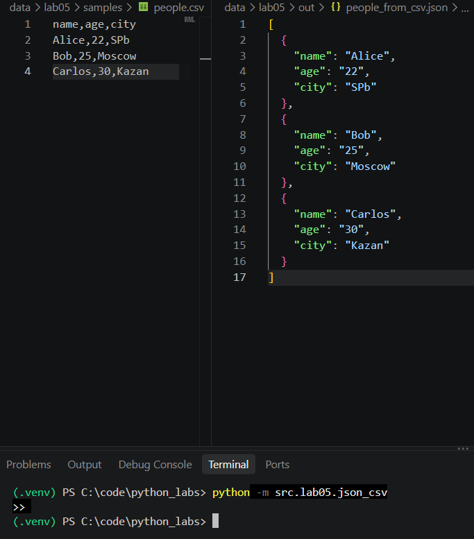
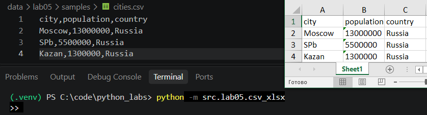

# ЛР5 — JSON и конвертации (JSON↔CSV, CSV→XLSX): Техническое задание

### Цель: Разобраться с форматом JSON, сериализацией/десериализацией и табличными конвертациями.

---

# Задание A

```py
import csv
import json
import sys
from pathlib import Path
from src.lib import text

def json_to_csv(json_path: str, csv_path: str) -> None:
    """
    Преобразует JSON-файл в CSV.
    Поддерживает список словарей [{...}, {...}].
    Кодировка UTF-8. Порядок колонок — как в первом объекте.

    """
    
    j_p = Path(json_path)
    c_p = Path(csv_path)
    
    if not j_p.exists():
        raise FileNotFoundError(f"Файл не найден: {json_path}")
        
    try:
        with j_p.open("r", encoding="utf-8") as f:
            data = json.load(f)
    except json.JSONDecodeError as e:
        print(f"битый JSON: {e.msg}, строка {e.lineno}", file=sys.stderr)
        sys.exit(1)
        
    if data is None or data == "" or data == []:
        raise ValueError("Неверный тип файла, пустой JSON или CSV")
    
    fieldnames = list(data[0].keys())

    c_p.parent.mkdir(parents=True, exist_ok=True)
    with c_p.open("w", newline="", encoding="utf-8") as f:
        writer = csv.DictWriter(f, fieldnames=fieldnames)
        writer.writeheader()
        writer.writerows(data)

def csv_to_json(csv_path: str, json_path: str) -> None:
    """
    Преобразует CSV в JSON (список словарей).
    Заголовок обязателен, значения сохраняются как строки.
    json.dump(..., ensure_ascii=False, indent=2)

    """

    c_p = Path(csv_path)
    j_p = Path(json_path)
    
    if not c_p.exists():
        raise FileNotFoundError(f"Файл не найден: {csv_path}")
        
    with c_p.open("r", encoding="utf-8", newline="") as f:
        reader = csv.DictReader(f)
        rows = list(reader)

    if len(rows) == 0:
        raise ValueError("Неверный тип файла, пустой JSON или CSV")
    
    j_p.parent.mkdir(parents=True, exist_ok=True)
    with j_p.open("w", encoding="utf-8") as f:
        json.dump(rows, f, ensure_ascii=False, indent=2)

if __name__ == '__main__':
    json_to_csv('data/lab05/samples/people.json', 'data/lab05/out/people_from_json.csv')
    csv_to_json('data/lab05/samples/people.csv', 'data/lab05/out/people_from_csv.json')
```

## Тест json -> csv


## Тест csv -> json


# Задание B

```py
import csv
from pathlib import Path
from openpyxl import Workbook

def csv_to_xlsx(csv_path: str, xlsx_path: str) -> None:
    """
    Конвертирует CSV в XLSX.
    Для конвертации используется библиотека openpyxl.
    Первая строка CSV — заголовок.
    Лист называется "Sheet1".

    """

    c_p = Path(csv_path)
    x_p = Path(xlsx_path)
    
    if not c_p.exists():
        raise FileNotFoundError(f"Файл не найден: {csv_path}")
        
    with c_p.open("r", encoding="utf-8", newline="") as f:
        reader = csv.reader(f)
        rows = list(reader)
        
    if len(rows) == 0:
        raise ValueError("Неверный тип файла, пустой JSON или CSV")
        
    wb = Workbook()
    ws = wb.active
    ws.title = "Sheet1"
    
    for row in rows:
        ws.append(row)
        
    x_p.parent.mkdir(parents=True, exist_ok=True)
    wb.save(x_p)

if __name__ == '__main__':
    csv_to_xlsx('data/lab05/samples/cities.csv', 'data/lab05/out/people.xlsx')
```

## Тест csv -> xlsx
