# ЛР6 — CLI‑утилиты с argparse (cat/grep‑lite + конвертеры)

### Цель: Научиться создавать консольные инструменты с аргументами командной строки, подкомандами и флагами.

---

# cli_text

```py
import argparse
from pathlib import Path
from src.lib import text


def cat(input_path, numbered=False):
    file_path = Path(input_path)
    if not file_path.is_file():
        raise FileNotFoundError(f"Файл не найден: {input_path}")

    with file_path.open("r", encoding="utf-8") as f:
        line_number = 1
        for line in f:
            if numbered:
                print(f"{line_number}: {line}", end="")
            else:
                print(line, end="")
            line_number += 1


def stats(input_path, top=5):
    file_path = Path(input_path)
    if not file_path.is_file():
        raise FileNotFoundError(f"Файл не найден: {input_path}")

    with file_path.open("r", encoding="utf-8") as f:
        content = f.read()

    clean_text = text.normalize(content)
    words = text.tokenize(clean_text)
    frequencies = text.count_freq(words)
    top_words = text.top_n(frequencies, n=top)

    print(f"Всего слов: {len(words)}")
    print(f"Уникальных слов: {len(frequencies)}")
    print(f"Топ-{top}:")
    for word, count in top_words:
        print(f"{word}: {count}")


def main():
    parser = argparse.ArgumentParser(description="CLI-утилиты")
    subparsers = parser.add_subparsers(dest="command", required=True)

    cat_parser = subparsers.add_parser("cat", help="Вывести содержимое файла")
    cat_parser.add_argument("--input", required=True, help="Путь к файлу")
    cat_parser.add_argument("-n", action="store_true", help="Нумеровать строки")

    stats_parser = subparsers.add_parser("stats", help="Частоты слов")
    stats_parser.add_argument("--input", required=True, help="Путь к файлу")
    stats_parser.add_argument("--top", type=int, default=5, help="Топ N слов")

    args = parser.parse_args()

    if args.command == "stats" and args.top < 1:
        parser.error("--top должен быть положительным числом")

    try:
        if args.command == "cat":
            cat(args.input, args.n)
        elif args.command == "stats":
            stats(args.input, args.top)
    except FileNotFoundError as e:
        parser.error(str(e))
    except UnicodeDecodeError:
        parser.error(f"Файл {args.input} не читается в кодировке UTF-8")


if __name__ == "__main__":
    main()
```

## Тесты

### 1. cat
```bash
python -m src.lab06.cli_text cat --input data/lab05/samples/people.csv -n
```
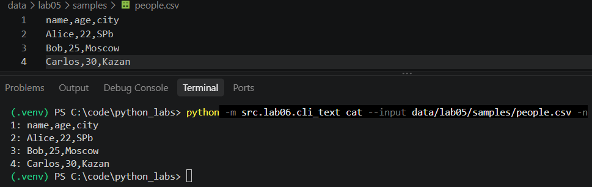

### 2. stats
```bash
python -m src.lab06.cli_text stats --input data/lab05/samples/people.txt --top 5
```
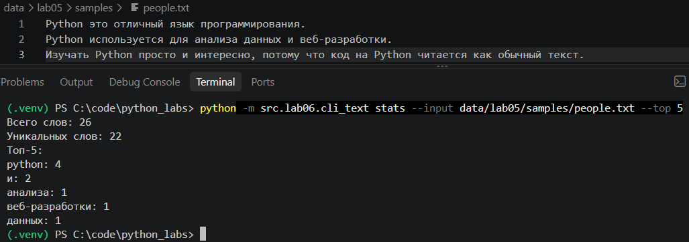

## Проверка

### 1.
```bash
python -m src.lab06.cli_text --help
```
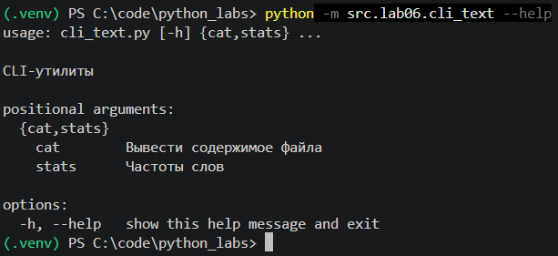

### 2.
```bash
python -m src.lab06.cli_text cat --help
```
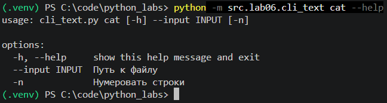

### 3.
```bash
python -m src.lab06.cli_text stats --help
```
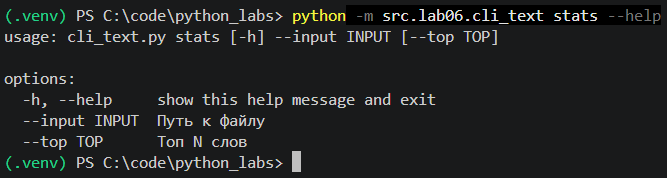

### 4.
```bash
python -m src.lab06.cli_text stats --input data/lab05/samples/people.txt --top -1
```
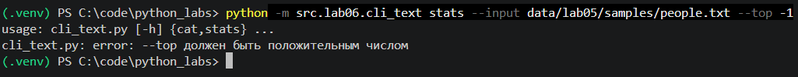

### 5.
```bash
python -m src.lab06.cli_text cat --input data/lab05/samples/no_such_file.txt
```
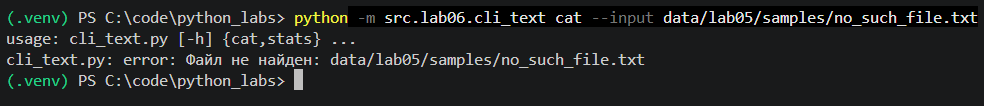

---

# cli_convert

```py
import argparse
from src.lab05.json_csv import json_to_csv, csv_to_json
from src.lab05.csv_xlsx import csv_to_xlsx


def main():
    parser = argparse.ArgumentParser(description="Конвертеры данных")
    sub = parser.add_subparsers(dest="cmd", required=True)

    p1 = sub.add_parser("json2csv", help="Преобразует .json в .csv")
    p1.add_argument("--in", dest="input", required=True, help="Входной файл .json")
    p1.add_argument("--out", dest="output", required=True, help="Выходной файл .csv")

    p2 = sub.add_parser("csv2json", help="Преобразует .csv в .json")
    p2.add_argument("--in", dest="input", required=True, help="Входной файл .csv")
    p2.add_argument("--out", dest="output", required=True, help="Выходной файл .json")

    p3 = sub.add_parser("csv2xlsx", help="Преобразует .csv в .xlsx")
    p3.add_argument("--in", dest="input", required=True, help="Входной файл .csv")
    p3.add_argument("--out", dest="output", required=True, help="Выходной файл .xlsx")

    args = parser.parse_args()

    try:
        if args.cmd == "json2csv":
            json_to_csv(args.input, args.output)
        elif args.cmd == "csv2json":
            csv_to_json(args.input, args.output)
        elif args.cmd == "csv2xlsx":
            csv_to_xlsx(args.input, args.output)
    except FileNotFoundError:
        parser.error(f"файл не найден: {args.input}")
    except ValueError as e:
        parser.error(str(e))


if __name__ == "__main__":
    main()
```

## Тесты

### 1. JSON -> CSV
```bash
python -m src.lab06.cli_convert json2csv --in data/lab05/samples/people.json --out data/lab05/out/people.csv
```
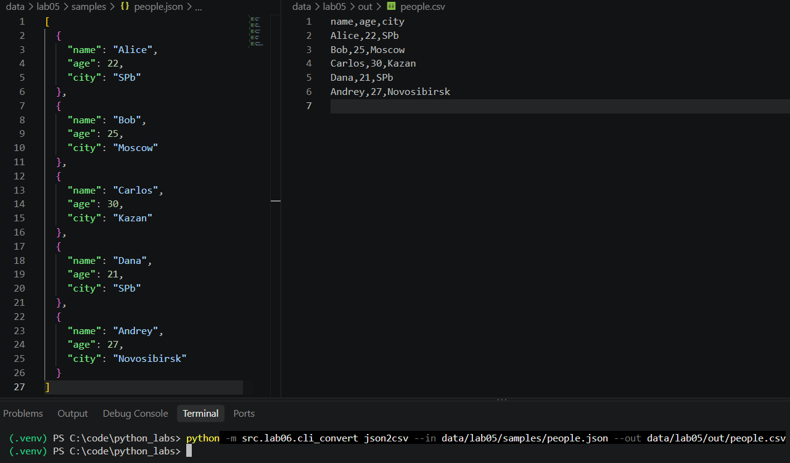

### 2. CSV -> JSON
```bash
python -m src.lab06.cli_convert csv2json --in data/lab05/samples/people.csv --out data/lab05/out/people.json
```
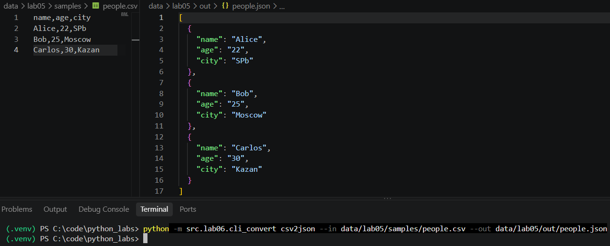

### 3. CSV -> XLSX
```bash
python -m src.lab06.cli_convert csv2xlsx --in data/lab05/samples/people.csv --out data/lab05/out/people.xlsx
```
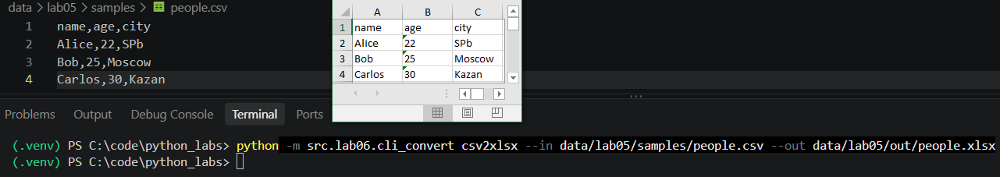

## Проверка

### 1.
```bash
python -m src.lab06.cli_convert --help
```
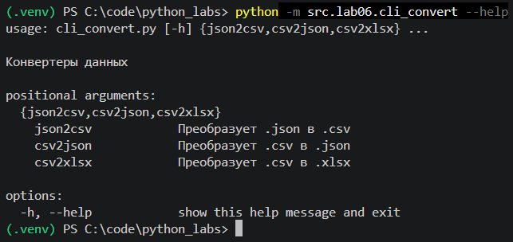

### 2.
```bash
python -m src.lab06.cli_convert json2csv --help
```
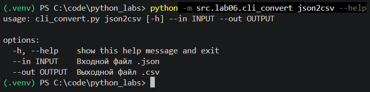